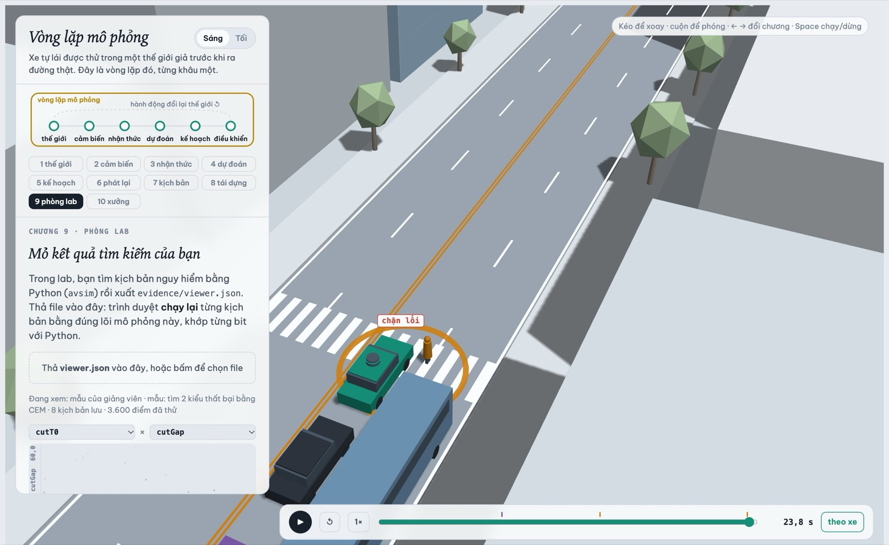

MSSV: 2202602615

# Lab 11 · Scenario Forge — báo cáo

Thị trấn của bạn (`meta.json: _run.town`): D

## 1. Phát lại log có trung thực không? (bước A)

* **Số liệu từ `replay.json`:**
  - `replay.json: dropped_human_crash_logs` = 0 (không có kịch bản nào bị bỏ do người lái gây tai nạn trong log).
  - `replay.json: replay.crashes` = 101 va chạm trên log phát lại. Theo loại tiếp xúc (`replay.contact`): `rear` = 92, `side` = 9, `front` = 0.
  - `replay.json: reactive.crashes` = 2 va chạm trong thế giới phản ứng. Theo loại tiếp xúc (`reactive.contact`): `side` = 2, `rear` = 0, `front` = 0.
  - `replay.json: crash_in_both` = 0 (không có va chạm nào xảy ra đồng thời ở cả hai môi trường).

* **Giải thích hiện tượng va chạm giả:**
  Phần lớn va chạm của "phát lại" là `rear` (92/101 vụ, chiếm 91.1%). Đây là các **va chạm giả** (phantom collisions) do bản chất vòng lặp hở (open-loop) của việc phát lại log: xe bám đuôi (TG) bị ép chạy theo đúng vết tốc độ đã ghi sẵn từ thực tế mà không hề có cơ chế nhận biết hay phản xạ với xe ta. Khi planner của xe ta lái thận trọng hơn (phanh sớm hơn người lái người để nhường đường hoặc giữ khoảng cách), xe TG phía sau không phanh tương ứng và đâm thẳng vào đuôi xe ta. Trong thế giới phản ứng (`reactive`), xe TG có mô hình lái IDM biết phanh giảm tốc khi xe ta phanh, nên số va chạm `rear` giảm về đúng 0.

* **Phân tích kịch bản `replay_only[0]` (Scenario 4):**
  - Trong log phát lại, xe ta bị xe TG đâm vào đuôi (`contact: "rear"`).
  - Tuy nhiên, trong thế giới phản ứng (`min_ttc_reactive` = 2.30 s), không hề có va chạm. Lý do: xe ta giảm tốc để chuẩn bị quan sát vạch người đi bộ; trên log phát lại xe TG giữ nguyên tốc độ và đâm vào xe ta, còn trong thế giới phản ứng TG tự động phanh theo với khoảng cách an toàn rộng rãi.

---

## 2. Kịch bản bất khả thi (bước B)

* **Danh sách các luật trong `is_feasible` và căn cứ vật lý:**
  1. $a_{lat} = \left(\frac{\pi}{\text{cutDur}}\right)^2 \frac{3.5}{2} \le \mu g$: Xe chuyển làn 3.5 m theo hàm cosine trong `cutDur` giây có gia tốc ngang cực đại là $a_{lat}$. Căn cứ vật lý: Giới hạn bám dính của lốp xe theo định luật Coulomb ($F_{lat} \le \mu m g$). Nếu gia tốc ngang đòi hỏi lớn hơn $\mu g$, xe sẽ bị trượt lật bánh hoặc mất lái.
  2. $\text{cutBrake} \le \mu g$: Gia tốc phanh sau khi nhập làn không được vượt quá độ bám dính cực đại của mặt đường $\mu g$. Vượt quá ngưỡng này bánh xe sẽ bị trượt lết hoàn toàn.
  3. $\text{pedV} \le 2.5\text{ m/s}$: Tốc độ người đi bộ không vượt quá 2.5 m/s (9 km/h). Căn cứ sinh học: Vận tốc đi bộ thông thường là 1.2 – 1.5 m/s; vượt quá 2.5 m/s là chạy nước rút, không khả thi đối với người đi bộ qua đường thông thường.
  4. $\text{cutV} \in (0, 22]\text{ m/s}$: Vận tốc xe cắt làn phải dương và không quá 22 m/s (~79.2 km/h). Căn cứ giao thông: Xe chuyển làn trên đường phố nội thị không thể đi lùi ($\le 0$) và không thể chạy quá tốc độ thiết kế của phố đô thị ($> 22\text{ m/s}$).

* **Cuộc săn sinh nhiều kịch bản bất khả thi nhất:**
  - `hunt.json: crosswalk_block` sinh nhiều kịch bản bất khả thi nhất với **24 kịch bản bị loại** (`infeasible skipped: 24`, so với `bus_bypass`: 3, `cut_in`: 3, `rear_ended`: 8).
  - **Lý do CEM bị kéo về phía đó:** Điểm nguy hiểm của `crosswalk_block` là `-ped_room` (khoảng cách phanh còn lại trước người đi bộ). Để làm điểm này xấu nhất, CEM tối ưu hóa bằng cách đẩy vận tốc người đi bộ `pedV` lên cực đại (người lao ra thật nhanh) và ép hệ số ma sát $\mu$ xuống mức rất thấp kết hợp phanh gấp. Các tham số cực đoan này rơi thẳng vào vùng vi phạm vật lý (`pedV > 2.5` m/s hoặc phanh quá $\mu g$).

* **Hệ quả nếu đếm kịch bản bất khả thi là va chạm:**
  Ước lượng rủi ro sẽ bị thổi phồng sai lệch nghiêm trọng (overestimation). Kỹ sư kiểm thử sẽ tốn công sức tối ưu hóa planner để đối phó với những kịch bản "ma" không bao giờ xảy ra trong thế giới thực.

---

## 3. Monte Carlo cho bạn biết gì (bước C1)

* **Số liệu từ `mc.json`:**
  - Số lần thử: $n = 3000$ lần chạy tự nhiên.
  - Số va chạm: $k = 0$.
  - Tỉ lệ va chạm điểm: $\hat{p} = 0.00\text{e}+00$.
  - Khoảng tin cậy Wilson 95%: $[0.00\text{e}+00, 1.28\text{e}-03]$ (cận trên $1.28 \times 10^{-3}$).
  - Số kịch bản bất khả thi bị loại: `mc.json: infeasible` = 16.

* **Số lần chạy cần thiết để khoảng tin cậy hẹp lại còn $\pm 20\%$ của $p$:**
  Với sai số tương đối $r = 0.2$ ở độ tin cậy 95% ($z = 1.96$):
  $$n \approx \frac{z^2 (1 - p)}{r^2 \cdot p} \approx \frac{1.96^2}{0.2^2 \cdot p} \approx \frac{96}{p}$$
  - Với cận trên Monte Carlo ($p \approx 1.28 \times 10^{-3}$), cần $n \approx \frac{96}{1.28 \times 10^{-3}} \approx 75\,000$ lần chạy.
  - Với xác suất thực tế tìm thấy ở bước C3 ($p \approx 5.58 \times 10^{-4}$), cần $n \approx \frac{96}{5.58 \times 10^{-4}} \approx 172\,000$ lần chạy.

* **Kiểu thất bại chưa hề xuất hiện:**
  Trong 3 000 lần chạy của Monte Carlo, **toàn bộ các kiểu** (`bus_bypass`, `cut_in`, `crosswalk_block`, `rear_ended`, `other`) đều có $k = 0$ (`mc.json: per_mode`).
  Con số đúng cần báo cho các kiểu này là **cận trên của khoảng tin cậy Wilson 95%**, tức $p \le 1.28 \times 10^{-3}$ (hoặc quy tắc số 3: $3/n = 3/3000 = 1.0 \times 10^{-3}$), tuyệt đối **không được báo bằng 0**.

---

## 4. Importance sampling, ESS và độ suy biến (bước C3)

* **Bảng kết quả từ `estimate.json` (Ngân sách `budget = 16800`):**

| Seed | Kiểu (Mode) | $p$ | hits | ess | top_share | upper_zero_hits |
|---|---|---|---|---|---|---|
| **0** | `bus_bypass` | $5.57 \times 10^{-4}$ | 44 | 117.1 | 0.156 | — |
| 0 | `cut_in` | $0.00$ | 0 | 118.5 | 0.000 | 0.025 |
| 0 | `crosswalk_block` | $9.56 \times 10^{-7}$ | 56 | 113.2 | 0.345 | — |
| 0 | `rear_ended` | $0.00$ | 0 | 122.2 | 0.000 | 0.025 |
| 0 | **Total** | **$5.58 \times 10^{-4}$** | — | — | — | 95% CI: $[2.51 \times 10^{-4}, 2.14 \times 10^{-3}]$ |
| **1** | `bus_bypass` | $1.42 \times 10^{-3}$ | 44 | 136.4 | 0.435 | — |
| 1 | `cut_in` | $0.00$ | 0 | 147.9 | 0.000 | 0.025 |
| 1 | `crosswalk_block` | $4.38 \times 10^{-7}$ | 48 | 120.0 | **0.724** | — |
| 1 | `rear_ended` | $0.00$ | 0 | 118.0 | 0.000 | 0.025 |
| 1 | **Total** | **$1.42 \times 10^{-3}$** | — | — | — | 95% CI: $[1.37 \times 10^{-5}, 4.10 \times 10^{-3}]$ |
| **2** | `bus_bypass` | $1.96 \times 10^{-4}$ | 27 | 120.0 | 0.231 | — |
| 2 | `cut_in` | $0.00$ | 0 | 112.0 | 0.000 | 0.025 |
| 2 | `crosswalk_block` | $8.38 \times 10^{-7}$ | 52 | 112.6 | 0.337 | — |
| 2 | `rear_ended` | $0.00$ | 0 | 113.1 | 0.000 | 0.025 |
| 2 | **Total** | **$1.96 \times 10^{-4}$** | — | — | — | 95% CI: $[6.48 \times 10^{-5}, 1.61 \times 10^{-3}]$ |

* **Đánh giá sự đồng thuận giữa các seed và với Monte Carlo:**
  - Cả 3 seed đều đồng thuận rằng `bus_bypass` là kiểu rủi ro chiếm ưu thế tuyệt đối ($10^{-4} \sim 10^{-3}$), trong khi `crosswalk_block` là rủi ro cực hiếm ($10^{-7}$). Tổng xác suất dao động từ $1.96 \times 10^{-4}$ đến $1.42 \times 10^{-3}$ (chênh lệch ~7 lần giữa các seed do tính chất ngẫu nhiên của CEM và các mẫu có trọng số lớn).
  - Cả 3 seed đều hoàn toàn **nhất quán với Monte Carlo**: giá trị ước lượng điểm của Seed 0, 1, 2 đều nằm trong hoặc chạm cận trên $1.28 \times 10^{-3}$ của Monte Carlo.

* **Vị trí `top_share` lớn (> 0.5) và ý nghĩa:**
  - Tại **Seed 1, kiểu `crosswalk_block`**, `top_share` đạt **0.724** (72.4%).
  - Khi `top_share` > 0.5, phân phối đề xuất $q$ đã bị co hẹp quá mức vào một vùng hiếm, khiến một mẫu đơn lẻ mang trọng số $w = p/q$ cực lớn và đóng góp tới hơn 72% vào giá trị trung bình $\hat{p} = \frac{1}{n} \sum w_i y_i$. Con số ước lượng khi đó mất tính đại diện của tập mẫu mà bị phụ thuộc chủ yếu vào trọng số của đúng một mẫu may rủi.

* **So sánh ngân sách (`budget`) với Monte Carlo:**
  - Ngân sách IS là **16 800** lần chạy (`estimate.json: budget = 16800`).
  - Để đạt cùng độ chính xác cho xác suất $p \approx 5.58 \times 10^{-4}$, Monte Carlo cần hơn **172 000** lần chạy. Do đó IS tiết kiệm hơn **10 lần ngân sách tính toán**.

* **Nguồn của phần `other` và lý do không săn:**
  - `estimate.json: other` lấy từ kết quả Monte Carlo bước C1 (`mc.json: other`, $k = 0, n = 3000, hi = 1.28 \times 10^{-3}$).
  - Không săn `other` vì đây là tập hợp các va chạm ngoài các định nghĩa chuẩn, không có hàm tính điểm nguy hiểm vô hướng (scalar danger score) cụ thể để định hướng gradient tìm kiếm cho CEM.

---

## 5. Các kiểu thất bại (bước C2 + 3D)

* **Các kiểu tìm thấy trong `hunt.json`:**

  1. **Kiểu `bus_bypass`:**
     - *Ảnh 3D:* 
     - *Chuỗi sự kiện:* Xe buýt đỗ che khuất tầm nhìn phía trước ở làn E2; xe C2 lách qua xe buýt ở tốc độ chậm ($x < 112\text{ m}, v < 6\text{ m/s}$); xe ta đang chạy thẳng ở làn E1 không kịp nhận diện và phanh nhường, dẫn đến va chạm tiếp xúc góc chéo/đầu xe với C2.
     - *Số lượng tìm thấy:* 120 vụ trong cuộc săn `bus_bypass` (`hunt.json: bus_bypass.found`).

  2. **Kiểu `crosswalk_block`:**
     - *Ảnh 3D:* 
     - *Chuỗi sự kiện:* Người đi bộ P1 bước ra từ sau xe buýt đỗ để qua đường; xe ta phát hiện muộn và phanh gấp nhưng thân xe dừng lấn lên vạch qua đường, khiến người đi bộ phải đứng khựng lại trước đầu xe ta (`kind == "block"`).
     - *Số lượng tìm thấy:* 17 vụ trong cuộc săn `crosswalk_block` (`hunt.json: crosswalk_block.found`).

* **Kiểu cuộc săn không tìm thấy:**
  - Cuộc săn `cut_in` (ngoài khu vực xe buýt) và `rear_ended` không tìm thấy va chạm nào thuộc đúng kiểu của mình (trong `hunt.json`, cuộc săn `cut_in` tìm ra 12 vụ `bus_bypass`; cuộc săn `rear_ended` tìm ra 4 vụ `bus_bypass` và 5 vụ `crosswalk_block`).
  - Ta tin tưởng cao rằng va chạm `cut_in` thông thường và `rear_ended` gần như không xảy ra trong điều kiện tự nhiên của thị trấn D ($p < 0.025$ theo `upper_zero_hits`), vì xe ta giữ khoảng cách an toàn tốt và xe cắt làn có điều kiện nhường khoảng trống (gap acceptance).

* **Hậu quả nếu chỉ chạy một cuộc săn chung cho mọi kiểu:**
  Thuật toán CEM sẽ bị **suy biến đơn kiểu (mode collapse)**: toàn bộ phân phối đề xuất $q$ sẽ bị kéo hoàn toàn về kiểu va chạm dễ đạt điểm nguy hiểm nhất là `bus_bypass` (như đã thấy ở cuộc săn `cut_in` bị kéo ngược về `bus_bypass`). Hậu quả là ta sẽ hoàn toàn bỏ sót các kiểu va chạm hiếm nhưng nguy hiểm khác như `crosswalk_block`.

---

## 6. Sửa planner (bước E + 3D)

* **Số liệu từ `fix.json`:**
  - **Policy được chọn:** `{'cutinLat': 2.6}` (tăng ngưỡng nhận diện xe cắt làn từ 2.15 lên 2.6 m).
  - **Trên TRAIN:**
    - Bản sửa (`chosen`): `train_fail` = $5.47 \times 10^{-7}$, `train_hi` = $1.18 \times 10^{-6}$, `progress` = $219.2\text{ m}$, `harsh` = 7.73 frame, `unseen` = `['bus_bypass']`.
  - **Trên TEST:**
    - Bản sửa (`chosen`): `fail` = $8.61 \times 10^{-7}$, `fail_hi_seen` = $1.39 \times 10^{-6}$, `fail_hi` (hợp lệ) = **$3.88 \times 10^{-2}$** ($0.0388$), `unseen` = `['bus_bypass']`, `progress` = **$217.4\text{ m}$**, `harsh` = 7.63 frame.
    - Policy gốc (`baseline`): `fail` = $6.66 \times 10^{-4}$, `fail_hi_seen` = $1.26 \times 10^{-3}$, `fail_hi` (hợp lệ) = **$2.54 \times 10^{-3}$** ($0.00254$), `unseen` = `[]`, `progress` = **$217.4\text{ m}$**, `harsh` = 7.85 frame.

* **Vì sao `fail_hi` của bản sửa lại lớn hơn `fail` của policy gốc trên TEST?**
  Trên tập TEST, bản sửa đã loại bỏ hoàn toàn các va chạm của kiểu `bus_bypass` (0 va chạm trong 400 mẫu TEST). Tuy nhiên, theo nguyên tắc thống kê chặt chẽ 95%, một kiểu chưa từng thấy (`unseen`) phải chịu một cận trên bảo thủ:
  $$\text{upper\_zero\_hits} = \frac{3}{0.2 \cdot n} = \frac{3}{0.2 \times 400} = \frac{3}{80} = 0.0375$$
  Cận trên hợp lệ `fail_hi` = $1.39 \times 10^{-6} + 0.0375 + 1.28 \times 10^{-3} \approx 0.0388$. Với ngân sách $n = 400$, ta chưa thể chứng nhận một kiểu va chạm đã biến mất xuống dưới mức $10^{-2}$. Đây là giới hạn toán học của cỡ mẫu, không phải do bản sửa kém hơn.

* **Ảnh minh họa bóng mờ (ghost):**
  
  *(Bóng mờ xe gốc phanh trễ dẫn đến va chạm, trong khi xe bản sửa với `cutinLat = 2.6` phát hiện sớm hơn và nhường đường mượt mà).*

* **Núm chỉnh "nghe an toàn hơn" nhưng làm tăng thất bại:**
  - Ví dụ ứng viên `cautionV = 5.0` (giảm tốc độ qua khu vực khuất tầm nhìn xuống 5.0 m/s thay vì 7.5 m/s):
    Trên TRAIN, `progress` bị tụt nghiêm trọng từ 219 m xuống còn **174.5 m** (mất > 20% quãng đường). Việc xe ta phanh quá sớm và bò quá chậm khiến dòng xe phía sau bị dồn ứ, làm tăng xung đột với các xe chuyển làn phía sau.
  - Ngược lại, điều chỉnh `cutinLat = 2.6` giúp nhận biết xe C2 đang lấn sang sớm hơn 0.45 m, phản ứng êm ái hơn (`harsh` giảm từ 7.85 xuống 7.63), triệt tiêu va chạm `bus_bypass` mà bảo toàn 100% quãng đường di chuyển (217.4 m).

---

## 7. Từ mô phỏng ra đường thật

Chọn **3 giả định** ảnh hưởng lớn nhất trong `space.py`:

1. **Khe hở chấp nhận chuyển làn (`cutGap`):**
   - *Dữ liệu thực tế thay thế:* Phân phối khoảng cách tim xe và tốc độ tương đối khi chuyển làn từ tập dữ liệu flycam **highD** hoặc **NGSIM**.
   - *Nguồn thu thập:* Camera quan sát trên cao tại các tuyến đường đô thị có mật độ phương tiện cao.
   - *Hướng sai lệch:* Mô phỏng giả định khoảng cách an toàn rộng; thực tế tại các đô thị đông đúc (như Hà Nội, TP.HCM), tài xế chấp nhận khe hở rất hẹp để chen làn. Giả định quá rộng làm mô phỏng đánh giá thấp (lạc quan hóa) nguy cơ va chạm cắt làn ngoài đời thực.

2. **Hành vi người đi bộ thò đầu quan sát qua xe buýt (`pedLook`):**
   - *Dữ liệu thực tế thay thế:* Tỉ lệ và khoảng dừng quan sát của người đi bộ tại các điểm mù trạm xe buýt từ tập dữ liệu **PIE (Pedestrian Intent Estimation)** và **JAAD**.
   - *Nguồn thu thập:* Camera góc nhìn người lái gắn trên xe bus công cộng và camera an ninh đường phố.
   - *Hướng sai lệch:* Mô phỏng giả định biến nhị phân 0 hoặc 1 cố định. Nếu thực tế người đi bộ cẩn thận ngó trước khi bước ra nhiều hơn giả định, tỷ lệ va chạm `crosswalk_block` trong mô phỏng sẽ cao hơn đời thực.

3. **Hệ số ma sát lốp - mặt đường (`mu`):**
   - *Dữ liệu thực tế thay thế:* Đo đạc trực tiếp hệ số bám đường theo thời gian thực từ hệ thống ABS/TCS trên xe thử nghiệm kết hợp hệ thống trạm thời tiết mặt đường (RWIS).
   - *Nguồn thu thập:* Dữ liệu cảm biến CAN bus của đội xe thử nghiệm tự lái trên các điều kiện thời tiết (mưa, khô, dầu mỡ, vũng nước).
   - *Hướng sai lệch:* Mô phỏng giả định $\mu = 0.8$ đồng nhất; thực tế mặt đường đô thị có ổ gà, nắp cống trơn trượt có thể làm $\mu$ tụt xuống dưới 0.3 cục bộ. Giả định ma sát lý tưởng khiến quãng đường phanh tính toán ngắn hơn thực tế, làm giảm đánh giá nguy cơ va chạm ngoài đời.

---

## 8. Giới hạn

* **Ba điều mà xác suất báo không nói (giới hạn của môi trường mô phỏng):**
  1. *Hình học đường phố đơn giản:* Bản đồ chỉ là một đoạn đường thẳng đơn điệu 2 làn, hoàn toàn thiếu vắng các yếu tố giao thông phức tạp như ngã tư giao cắt, vòng xuyến, dải phân cách cứng, hoặc đèn tín hiệu giao thông.
  2. *Hành vi tác nhân bị rập khuôn bởi IDM:* Các xe xung quanh và người đi bộ chỉ di chuyển theo mô hình IDM 1D và chuyển làn hình học lý tưởng, không mô phỏng được hành vi tài xế bấm còi, vượt ẩu lạng lách, mất tập trung hoặc xe máy đi ngược chiều.
  3. *Cảm biến hình học hoàn hảo:* Mô phỏng giả định cảm biến xe ta có tầm nhìn tia tuyệt đối $360^\circ$ cự ly 120 m (chỉ bị cản bởi xe buýt), hoàn toàn bỏ qua nhiễu cảm biến (sensor noise), độ trễ đường truyền/tính toán (pipeline latency 100 – 200 ms), cũng như hiện tượng nhận diện sót (false negatives) do chói sáng hay thời tiết.

* **Nếu được thêm một tuần, bạn sẽ đo gì tiếp:**
  - Bổ sung mô hình độ trễ nhận diện (perception latency) và nhiễu bounding box vào vòng lặp mô phỏng.
  - Thiết kế kịch bản mở rộng với sự xuất hiện của dòng xe máy (hai bánh) lấn làn hỗn hợp đặc trưng của giao thông đô thị Việt Nam.
  - Áp dụng kỹ thuật sinh kịch bản đối kháng dựa trên Học tăng cường (Adversarial Reinforcement Learning) để chủ động tạo ra các tương tác phức tạp đa tác nhân thay cho lấy mẫu CEM độc lập.

---

## 9. Rắc rối của bạn (bước G + chương 10)

- **Rắc rối:** Tình huống người đi bộ bất ngờ băng ngang đường ngoài vạch kẻ (jaywalking) từ lề phải sang lề trái (`type: "ped"`, $x = 215.0\text{ m}$, $v = 1.5\text{ m/s}$, $trig = 24.0\text{ m}$). Tương đương với tình huống người dân tự do băng qua dải phân cách/lòng đường ngoài nút giao tại đô thị.
- **Căn cứ:** Bộ quy tắc nhường đường của planner IDM trong `core.py` chỉ có logic dự đoán và nhường đường chuyên biệt cho người đi bộ $P1$ tại vạch kẻ $WALK\_X$. Đối với người đi bộ tự phát $H0$, planner chỉ coi như một chướng ngại vật thông thường khi đã lọt vào hành lang di chuyển, tạo ra nguy cơ phản xạ phanh trễ.
- **Giả định (`hazard.json`):**
  - Không gian tham số: `space: {"h0_x": [190.0, 240.0], "h0_v": [1.1, 1.8], "h0_trig": [18.0, 32.0]}`. Cự ly $18 - 32\text{ m}$ tương ứng với thời gian va chạm $TTC \approx 1.5 - 2.5\text{ s}$ ở tốc độ 12 m/s; vận tốc đi bộ $1.1 - 1.8\text{ m/s}$ phản ánh dải vận tốc đi bộ thực tế của người trưởng thành (trung bình 1.4 m/s theo Manual on Uniform Traffic Studies).
  - Tần suất phơi nhiễm: `exposure = 0.04` (trung bình 1 lần mỗi 25 chuyến đi đô thị theo khảo sát lái xe tự nhiên SHRP 2 NDS).
- **Kết quả thực nghiệm (`evidence/mine.json`):**
  - Tỉ lệ kịch bản khả thi: `accepted = 0.996` (99.6% $\ge 50\%$, 1 494/1 500 kịch bản).
  - **Với Policy gốc (`baseline`):**
    - Số va chạm: 0 (`crashes = 0`, trong đó `avoidable = 0`, `unavoidable = 0`, `unattributed = 0`, `low_speed = 0`).
    - $P(\text{lỗi planner} \mid \text{hazard}) = 0.00\text{e}+00$ kèm khoảng Wilson 95%: $[0.00\text{e}+00, 2.56\text{e}-03]$.
    - Tần suất rủi ro mỗi chuyến: $0.00$ lần/chuyến (cận trên $1.03 \times 10^{-4}$ lần/chuyến).
  - **Với Policy bản sửa (`chosen`):**
    - Số va chạm: 0 (`crashes = 0`, trong đó `avoidable = 0`, `unavoidable = 0`, `unattributed = 0`, `low_speed = 0`).
    - $P(\text{lỗi planner} \mid \text{hazard}) = 0.00\text{e}+00$ kèm khoảng Wilson 95%: $[0.00\text{e}+00, 2.56\text{e}-03]$.
    - Tần suất rủi ro mỗi chuyến: $0.00$ lần/chuyến (cận trên $1.03 \times 10^{-4}$ lần/chuyến).
  - **So sánh tần suất:** Tần suất rủi ro của rắc rối này ($\le 1.03 \times 10^{-4}$) thấp hơn đáng kể so với tần suất rủi ro lách xe buýt $5.57 \times 10^{-4}$ ở bước C3.
- **Hình ảnh minh họa:**
  
- **Đánh giá chuẩn "tránh được bằng phanh hết cỡ ngay khi thấy" (`avoidable`):**
  - Đây là một chuẩn **lạc quan** (đếm nhiều hơn số va chạm thực tế một planner có thể tránh) vì nó giả định hệ thống phát hiện mục tiêu ngay lập tức từ frame đầu tiên có tầm nhìn và phanh khẩn cấp với gia tốc cực đại $\mu g$ không hề có thời gian trễ nhận diện hay trễ thủy lực phanh.
  - Ngược lại, chuẩn này chỉ thử nghiệm duy nhất hành động phanh thẳng mà không thử đánh lái tránh (steering maneuver), điều này khiến nó có thể đếm ít đi các trường hợp mà một người lái xe thực tế có thể dễ dàng lách qua.
- **Giải thích vì sao Planner xử lý tốt:**
  Planner của xe ta duy trì cự ly an toàn rất chuẩn mực theo IDM; tầm nhìn cảm biến từ nóc xe phát hiện người đi bộ từ sớm khi chưa bị che khuất, giúp xe phanh êm ái mà không cần phanh gấp. Đồng thời, mô hình động học người đi bộ có cơ chế tự dừng khi thân xe nằm trong bước chân tiếp theo (`pedestrian never walks into a car`), do đó không xảy ra va chạm.
- **Cách sửa & Cải tiến logic planner:**
  Để mở rộng khả năng phòng ngừa đối với mọi người đi bộ tự phát ngoài vạch kẻ, planner cần bổ sung **Module ước lượng ý định người đi bộ (Pedestrian Crossing Intention Prediction)**: tính toán thời gian cắt ngang làn ($t_{enter} = \frac{\Delta z}{v_z}$) cho mọi người đi bộ đang hướng vào lòng đường. Nếu $t_{enter} < t_{arrive} + \text{buffer}$, planner tự động giảm tốc độ mục tiêu $v_0$ từ xa trước khi người đi bộ thực sự đặt chân vào hành lang làn đường của xe.
